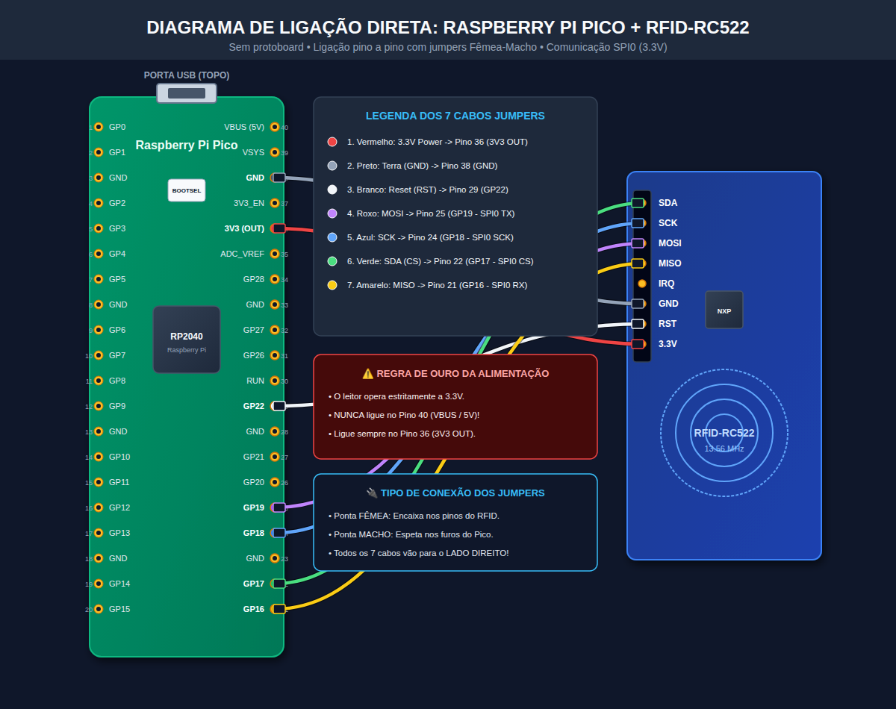

# Porta-LAOB 🚪🔑

Sistema de controle de acesso para porta do laboratório LAOB utilizando leitor RFID-RC522, acionamento eletrônico de fechadura e suporte nativo ao **Raspberry Pi Pico (RP2040)**.

> 📖 **Guia Rápido e Montagem Física:**
> * 🔌 [**Diagrama Detalhado de Montagem com Macho/Fêmea (docs/DIAGRAMA_MONTAGEM.md)**](docs/DIAGRAMA_MONTAGEM.md)
> * 📝 [**Tutorial Passo a Passo de Instalação (TUTORIAL_PASSO_A_PASSO.md)**](TUTORIAL_PASSO_A_PASSO.md)

---

## 🎯 Missão 1: Tratamento do RFID-RC522 e o Desafio da Interrupção (IRQ)

### O Problema Encontrado
A biblioteca padrão para o leitor RC522 (`miguelbalboa/rfid`) inclui um exemplo chamado `MinimalInterrupt.ino`, porém **ele não funciona na prática** para a maioria dos desenvolvedores. Os sintomas comuns são:
1. **Travamento no boot:** O código congela dentro do `setup()` devido ao laço bloqueante `do { } while (!bNewInt);`.
2. **Leitura única:** Após ler o primeiro cartão, a linha IRQ não desarma corretamente e o leitor para de responder.
3. **Mito do "Wake-on-Card":** O chip MFRC522 **não possui hardware de detecção autônoma de presença de cartão (LPCD)** como o PN532. Ele não acorda um microcontrolador em Deep Sleep por aproximação sem que o transmissor esteja emitindo o comando `REQA`.

### A Solução Implementada no Porta-LAOB
Desenvolvemos soluções completas, testadas e prontas para uso:
* **MicroPython Dual-Core com Auto-Boot ([`micropython/main.py`](micropython/main.py)):** Aproveita os 2 núcleos do processador RP2040 do Raspberry Pi Pico. O **Core 1** varre o leitor RFID em tempo real em segundo plano, enquanto o **Core 0** gerencia a fechadura, botoeira de saída interna, sensor de porta aberta e feedback sonoro.
* **MicroPython com IRQ por Hardware ([`micropython/rc522_irq.py`](micropython/rc522_irq.py) e [`micropython/main_irq.py`](micropython/main_irq.py)):** Configuração direta dos registradores `ComIEnReg` e `DivIEnReg` sem travamentos de boot e com re-armação automática.
* **Gerenciador de Acesso Completo ([`micropython/door_manager.py`](micropython/door_manager.py)):** Persistência de crachás em JSON na memória flash, modo Master (cadastre novos crachás aproximando o cartão administrador), botoeira de saída e logs de auditoria.
* **Driver C++ Multiplataforma ([`include/RC522_Interrupt.h`](include/RC522_Interrupt.h) e [`src/RC522_Interrupt.cpp`](src/RC522_Interrupt.cpp)):** Para uso com Arduino IDE ou Pico C/C++ SDK.

---

## 📁 Estrutura do Repositório

```text
Porta-LAOB/
├── TUTORIAL_PASSO_A_PASSO.md              # Guia completo mastigadinho de montagem e uso
├── micropython/
│   ├── main.py                            # Script principal auto-executável no boot do Pico
│   ├── mfrc522.py                         # Driver MFRC522 corrigido e otimizado (4 e 7 bytes)
│   ├── rc522_irq.py                       # Driver com interrupção por hardware (IRQ)
│   ├── door_manager.py                    # Gerenciador da fechadura, tags JSON, admin e logs
│   ├── main_irq.py                        # Exemplo alternativo via pino IRQ
│   └── main_multicore.py                  # Exemplo simplificado de uso Dual-Core
├── tools/
│   └── pico_tool.py                       # Ferramenta CLI de detecção, upload e monitor serial
├── tests/
│   └── test_door_logic.py                 # Suíte de testes unitários automatizados (100% aprovada)
├── docs/
│   ├── DIAGRAMA_MONTAGEM.md               # Guia visual com fotos e conectores macho/fêmea
│   ├── analise_interrupcao_rc522.md       # Estudo aprofundado dos registradores e bugs
│   └── images/                            # Fotos de alta definição da ligação direta
├── diagram.json                           # Simulação visual interativa 2D do Wokwi
├── wokwi.toml                             # Configuração do simulador Wokwi
├── include/
│   └── RC522_Interrupt.h                 # Driver C++ para Arduino/Pico C SDK
├── src/
│   └── RC522_Interrupt.cpp               # Implementação C++ com controle de registradores
├── examples/
│   ├── BasicInterrupt/
│   │   └── BasicInterrupt.ino             # Exemplo básico C++ de interrupção
│   └── ESP32_FreeRTOS_Async/
│       └── ESP32_FreeRTOS_Async.ino       # Arquitetura com FreeRTOS para ESP32
└── README.md
```

---

## 🔌 Ligação Direta Fio-a-Fio (Sem Protoboard)

> 💡 **Vantagem do Raspberry Pi Pico:** Opera nativamente em **3.3V**, garantindo 100% de compatibilidade elétrica e segurança para o leitor RC522 sem risco de queima.


*Diagrama esquemático de alta precisão com os 40 pinos oficiais do Pico e os 8 pinos do RC522.*

| Componente | Pino no Módulo | Pino Físico no Pico | GPIO RP2040 |
| :--- | :--- | :--- | :--- |
| **MFRC522** | **3.3V (VCC)** | **Pino 36** | `3V3 OUT` *(estritamente 3.3V)* |
| **MFRC522** | **GND** | **Pino 38** | `GND` |
| **MFRC522** | **RST** | **Pino 29** | `GP22` |
| **MFRC522** | **IRQ** | **Pino 18** | `GP14` *(interrupção de hardware)* |
| **MFRC522** | **MISO** | **Pino 21** | `GP16` *(SPI0 RX)* |
| **MFRC522** | **MOSI** | **Pino 25** | `GP19` *(SPI0 TX)* |
| **MFRC522** | **SCK** | **Pino 24** | `GP18` *(SPI0 SCK)* |
| **MFRC522** | **SDA (CS)** | **Pino 22** | `GP17` *(SPI0 CSn)* |
| --- | --- | --- | --- |
| **Trava/Fechadura**| **Relé (Sinal)** | **Pino 19** | `GP15` |
| **Botoeira Saída** | **Botão Interno**| **Pino 17** | `GP13` *(Pull-up interno)* |
| **Buzzer** | **Buzzer (+)** | **Pino 16** | `GP12` *(PWM opcional)* |
| **Sensor de Porta**| **Reed Switch** | **Pino 15** | `GP11` *(Opcional)* |

---

## 🚀 Como Colocar para Funcionar Agora

1. Conecte o Pico no PC e abra o **Thonny IDE**.
2. Copie para a raiz (`/`) do Raspberry Pi Pico os arquivos da pasta `micropython/`:
   * `mfrc522.py`
   * `door_manager.py`
   * `main.py`
3. Ao ligar a placa, o `main.py` rodará automaticamente!
4. **Primeiro uso:** Aproxime o crachá que você deseja que seja o **Administrador (Master)**. O sistema salvará e confirmará com bip.
5. Para cadastrar novos alunos, aproxime o crachá Master (entra no modo cadastro) e em seguida aproxime a tag do aluno!
