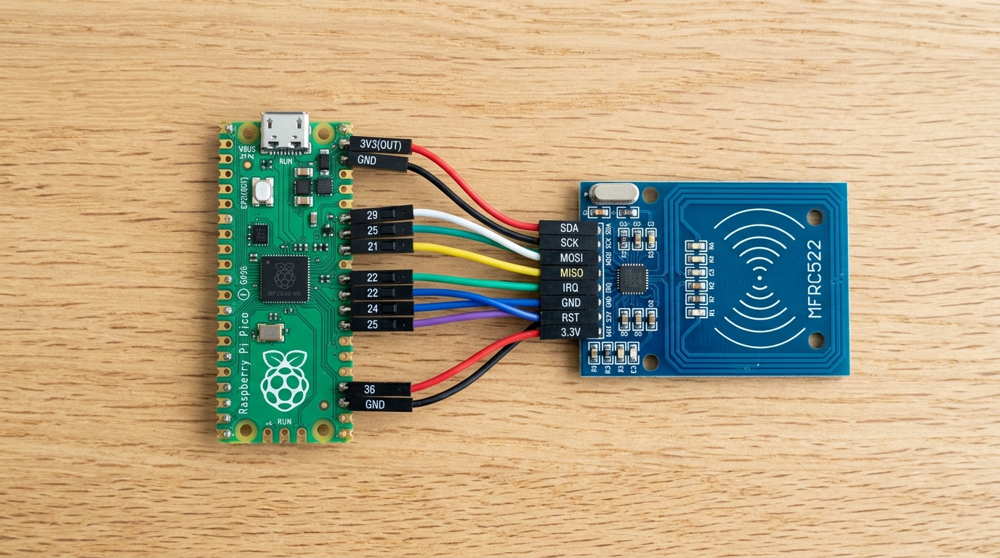
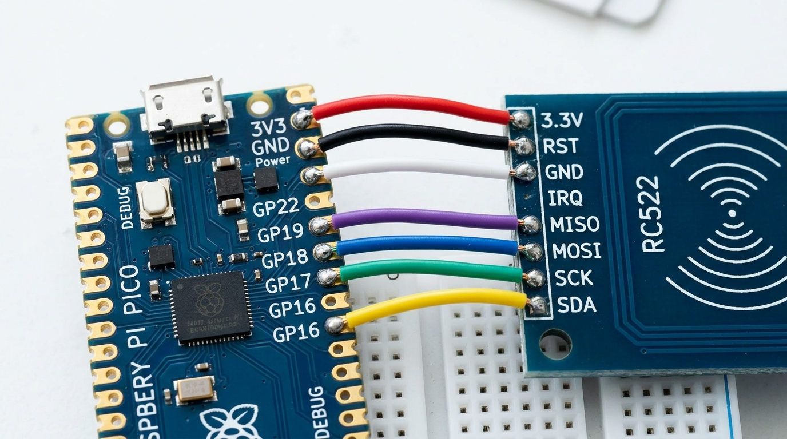
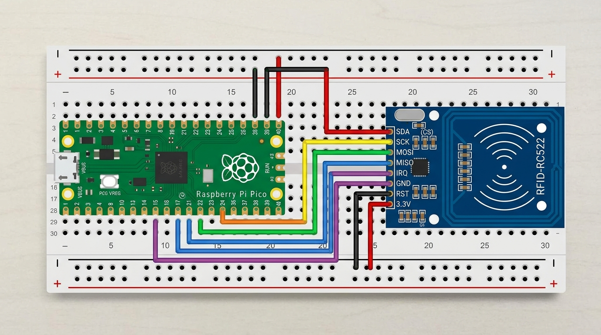

# 🔌 Diagrama de Ligação Direta Fio-a-Fio (SEM PROTOBOARD)

Este guia foi feito sob medida para quem **NÃO vai usar protoboard** e deseja conectar o Raspberry Pi Pico diretamente ao Leitor RFID-RC522 apenas com os fios jumpers coloridos sobre a mesa.

---

## 📸 1. Foto Real da Ligação Direta (Sem Protoboard)

Abaixo está a visualização exata de como as duas placas ficam lado a lado sobre a mesa, com cada fio saindo do leitor RFID e entrando diretamente no Raspberry Pi Pico:



---

## 📸 2. Foto em Detalhe dos Pinos



---

## 🎛️ 2. Montagem Geral na Protoboard

Caso você esteja usando uma protoboard (matriz de contatos) para organizar os componentes:



---

## 🌐 3. Simulação Visual Interativa no Wokwi

Adicionamos suporte nativo ao **[Wokwi](https://wokwi.com)**, o simulador eletrônico visual mais avançado da atualidade para Raspberry Pi Pico:

* O arquivo [`diagram.json`](../diagram.json) já está na raiz do projeto com todos os componentes pré-conectados:
  * Raspberry Pi Pico (RP2040)
  * Módulo Leitor RFID-RC522
  * Módulo Relé para Trava da Porta
  * Botoeira de Saída Interna
  * Buzzer de Alerta Sonoro
* **Como visualizar no navegador:**
  1. Acesse [wokwi.com](https://wokwi.com).
  2. Clique em **Raspberry Pi Pico**.
  3. Cole o conteúdo de [`diagram.json`](../diagram.json) na aba de diagrama para ver o circuito interativo 2D com fios coloridos!

---

## 🧐 4. Entendendo os Cabos e Conectores (Macho vs Fêmea)

Identifique as duas pontas dos seus fios jumpers:

* **Ponta FÊMEA (Oco / Entrada de Plástico):**  
  Possui um conector quadrado de plástico com um buraquinho no meio. Ela **abraça por cima** os pinos de metal salientes do leitor RFID.
  ```text
  [======== FÊMEA ]  <-- Encaixa nos pinos machos do Leitor RC522
  ```
* **Ponta MACHO (Agulha / Pino Metálico):**  
  Possui um pino rígido de metal exposto. Ela **espeta** nos furos da protoboard ou nos conectores fêmea.
  ```text
  [======== MACHO ]===>  <-- Espeta na protoboard ou furos do Pico
  ```

---

## 📋 5. Tabela de Ligação Passo a Passo (Fio por Fio)

Segure o Pico com a **entrada USB virada para CIMA**. Siga esta ordem de cores e pinos:

| Cabo | Pino no Leitor RFID | Ponta no RFID | Cor Recomendada | Ponta no Pico | Pino no Pico (Posição Física) | Função |
| :---: | :--- | :---: | :---: | :---: | :--- | :--- |
| **1** | **3.3V (VCC)** | **FÊMEA** | 🔴 Vermelho | **MACHO** | **Pino 36 (`3V3_OUT`)**: Lado direito, 5º de cima para baixo | Alimentação 3.3V |
| **2** | **GND** | **FÊMEA** | ⚫ Preto | **MACHO** | **Pino 38 (`GND`)**: Lado direito, 3º de cima para baixo | Terra comum |
| **3** | **RST** | **FÊMEA** | ⚪ Branco | **MACHO** | **Pino 29 (`GP22`)**: Lado direito, 12º de cima para baixo | Reset |
| **4** | **MOSI** | **FÊMEA** | 🟣 Roxo | **MACHO** | **Pino 25 (`GP19`)**: Lado direito, 5º de baixo para cima | SPI0 TX |
| **5** | **SCK** | **FÊMEA** | 🔵 Azul | **MACHO** | **Pino 24 (`GP18`)**: Lado direito, 4º de baixo para cima | SPI0 Clock |
| **6** | **SDA (CS)** | **FÊMEA** | 🟢 Verde | **MACHO** | **Pino 22 (`GP17`)**: Lado direito, 2º de baixo para cima | SPI0 Chip Select |
| **7** | **MISO** | **FÊMEA** | 🟡 Amarelo | **MACHO** | **Pino 21 (`GP16`)**: Lado direito, **o último pino lá embaixo** | SPI0 RX |
| **8** | **IRQ** *(opc.)* | **FÊMEA** | 🔘 Cinza | **MACHO** | **Pino 19 (`GP14`)**: Lado esquerdo, 2º de baixo para cima | Interrupção |

---

## ⚠️ 6. Atenção a Três Detalhes Críticos:

1. **Alimentação Estrita de 3.3V:**  
   O pino 40 do Pico (canto superior direito) fornece **5V da USB**. **NUNCA ligue o leitor RFID no pino 40**, pois o chip RC522 não tolera 5V e queimará. Conecte estritamente no **Pino 36 (`3V3 OUT`)**.
2. **Ordem dos Pinos no Leitor RC522:**  
   Sempre confira os nomes impressos na placa do leitor. A sequência padrão é:  
   `SDA` — `SCK` — `MOSI` — `MISO` — `IRQ` — `GND` — `RST` — `3.3V`.
3. **Firmeza dos Conectores:**  
   Certifique-se de que a ponta fêmea está bem ajustada no pino metálico e não está frouxa. Mau contato é o principal motivo de falha de leitura em módulos SPI.
