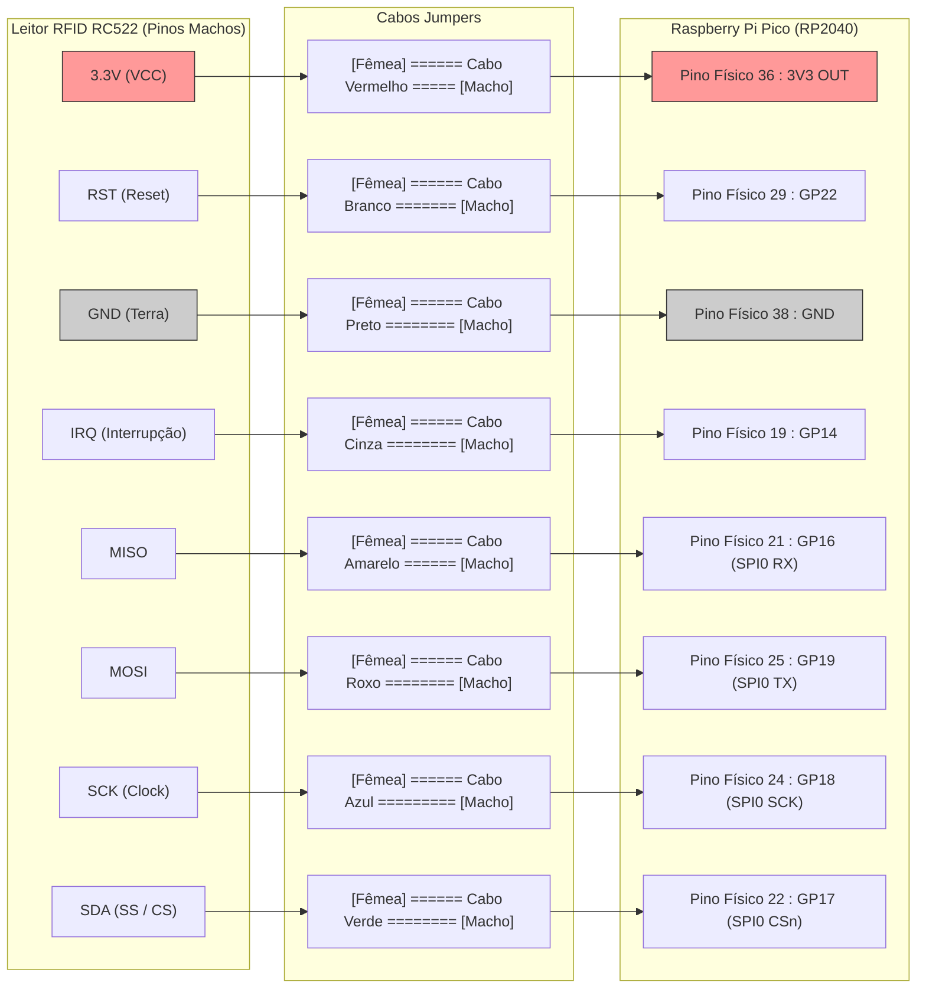

# 🔌 Diagrama Detalhado de Montagem e Pinagem: RC522 + Raspberry Pi Pico

Este documento ilustra com precisão **onde**, **como** e com **quais pontas de fios (Macho e Fêmea)** conectar o Leitor RFID-RC522 ao Raspberry Pi Pico.

---

## 🧐 1. Entendendo os Cabos e Conectores

Antes de plugar qualquer fio, identifique as duas pontas dos seus cabos jumpers:

* **Ponta FÊMEA (Oco / Entrada):** Possui um orifício retangular de plástico preto. Ela **abraça/encaixa por cima** de um pino de metal saliente.
  ```text
  [======== FÊMEA ]  <-- Encaixa nos pinos do leitor RC522
  ```
* **Ponta MACHO (Agulha / Pino):** Possui um pino rígido de metal exposto na ponta. Ela **espeta** em furinhos da protoboard ou em conectores fêmea.
  ```text
  [======== MACHO ]===>  <-- Espeta na protoboard ou furos do Pico
  ```

---

## 📌 2. O que tem em cada placa?

1. **Na placa do Leitor RFID (RC522):**
   * Possui uma fileira de **8 pinos metálicos salientes (MACHOS)**.
   * Portanto, **no leitor RFID SEMPRE entrará a ponta FÊMEA do cabo**.

2. **No Raspberry Pi Pico:**
   * **Cenário A (Mais comum - Pico com pinos em uma Protoboard):** Se o seu Pico está espetado numa protoboard branca, você usará a **ponta MACHO** do cabo espetada no furinho da protoboard alinhado com o pino do Pico. *(Cabo FÊMEA -> MACHO)*.
   * **Cenário B (Pico com pinos machos soldados para cima):** Você encaixará a **ponta FÊMEA** diretamente no pino do Pico. *(Cabo FÊMEA -> FÊMEA)*.

---

## 🗺️ 3. Diagrama Visual Completo de Ligação

```text
       LEITOR RFID-RC522                              RASPBERRY PI PICO
     +-------------------+                             +---------------+
     |                   |              CABOS          |  [PORTA USB]  |
     |              [SDA]| [Fêmea]================[Macho]| Pino 22 (GP17)|
     |              [SCK]| [Fêmea]================[Macho]| Pino 24 (GP18)|
     |             [MOSI]| [Fêmea]================[Macho]| Pino 25 (GP19)|
     |             [MISO]| [Fêmea]================[Macho]| Pino 21 (GP16)|
     |              [IRQ]| [Fêmea]================[Macho]| Pino 19 (GP14)|  <-- (Opcional)
     |              [GND]| [Fêmea]================[Macho]| Pino 38 (GND) |
     |              [RST]| [Fêmea]================[Macho]| Pino 29 (GP22)|
     |             [3.3V]| [Fêmea]================[Macho]| Pino 36 (3V3) |
     +-------------------+                             +---------------+
```

---

## 📊 4. Diagrama Esquemático Interativo (Mermaid)



---

## 📋 5. Tabela de Ligação Passo a Passo (Fio por Fio)

Segure o Pico com a **entrada USB virada para CIMA**.  
Siga a sequência abaixo para ligar cada um dos 8 cabos:

| Passo | Pino no Leitor RC522 | Ponta no RC522 | Cor Recomendada | Ponta no Pico | Pino no Pico (Posição Física) |
| :---: | :--- | :---: | :---: | :---: | :--- |
| **1** | **3.3V (VCC)** | **FÊMEA** | 🔴 Vermelho | **MACHO** | **Pino 36 (3V3_OUT)**: Lado direito, 5º pino de cima para baixo |
| **2** | **GND** | **FÊMEA** | ⚫ Preto | **MACHO** | **Pino 38 (GND)**: Lado direito, 3º pino de cima para baixo |
| **3** | **RST** | **FÊMEA** | ⚪ Branco | **MACHO** | **Pino 29 (GP22)**: Lado direito, 12º pino de cima para baixo |
| **4** | **MISO** | **FÊMEA** | 🟡 Amarelo | **MACHO** | **Pino 21 (GP16)**: Lado direito, **o último pino lá embaixo** |
| **5** | **SDA (SS/CS)**| **FÊMEA** | 🟢 Verde | **MACHO** | **Pino 22 (GP17)**: Lado direito, o 2º pino de baixo para cima |
| **6** | **SCK** | **FÊMEA** | 🔵 Azul | **MACHO** | **Pino 24 (GP18)**: Lado direito, o 4º pino de baixo para cima |
| **7** | **MOSI** | **FÊMEA** | 🟣 Roxo | **MACHO** | **Pino 25 (GP19)**: Lado direito, o 5º pino de baixo para cima |
| **8** | **IRQ** *(opcional)*| **FÊMEA** | 🔘 Cinza | **MACHO** | **Pino 19 (GP14)**: Lado esquerdo, o 2º pino de baixo para cima |

---

## ⚠️ 6. Atenção a Três Detalhes Importantes:

1. **Cuidado com a Tensão:**  
   O pino 40 do Pico (canto superior direito) fornece **5V** da USB. **NÃO LIGUE O LEITOR NO PINO 40**. O leitor queima com 5V. Ligue sempre no **Pino 36 (3V3 OUT)**.
2. **Ordem dos Pinos no Leitor RC522:**  
   Verifique as letras escritas na serigrafia da placa do seu RC522. A ordem padrão é:  
   `SDA` - `SCK` - `MOSI` - `MISO` - `IRQ` - `GND` - `RST` - `3.3V`.
3. **Pinos Firmeza dos Jumpers:**  
   Certifique-se de que a ponta fêmea abraçou bem o pino metálico e não está solta ou frouxa. Mau contato é o motivo nº 1 de falhas em leitores RFID.

---

## ✅ Pronto para ligar!
Após encaixar esses fios, conecte o cabo USB do Pico ao computador e nos avise para iniciarmos os testes pelo terminal!
